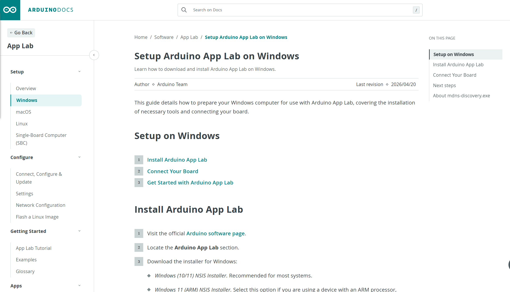
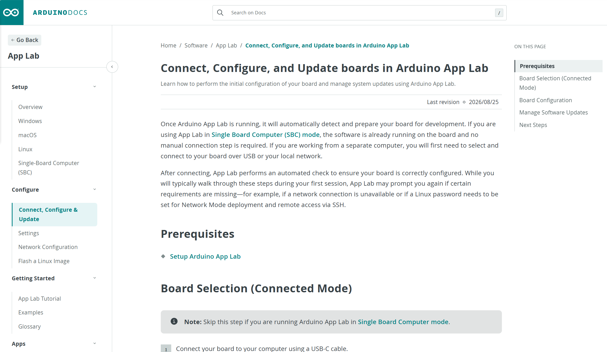
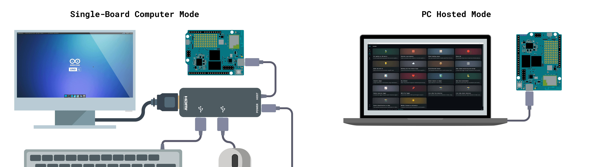
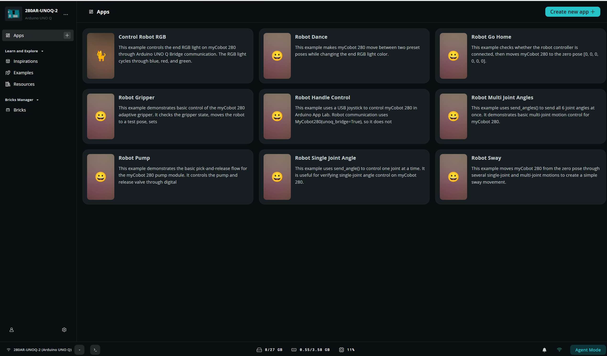

# 6.2.1 App Lab 基础使用

本节说明如何安装并连接 Arduino App Lab、导入 myCobot 案例 ZIP，以及在 App 中修改 `python/main.py`。请先完成本节 RGB 验证，再进入手柄或其他开发内容。

App Lab 节总览见 [6.2 README](./README.md)。板端 Debian Python、TCP Socket 见 [6.1](../6.1-python/README.md)。

## 1. 先阅读 UNO Q 官方用户手册

UNO Q 的供电、USB-C、显示、网络和系统功能以 Arduino 官方资料为准。首次开机或连接外设时，请先阅读 [Arduino UNO Q User Manual](https://docs.arduino.cc/tutorials/uno-q/user-manual/)。

本 GitBook 只说明 UNO Q 与 myCobot 280 的配合使用，不替代官方板卡手册。若与官方说明冲突，以官方最新版为准。

## 2. App Lab 使用方式

| 方式 | 适用对象 | 建议用途 |
| --- | --- | --- |
| PC-hosted | 首次使用者、普通客户 | 电脑通过 USB-C 连接 UNO Q，导入并运行案例；**推荐起点** |
| SBC | 有显示器、键鼠的用户 | 直接在 UNO Q 上运行 App Lab；手柄案例使用此方式 |

同一时刻只允许一个程序控制机械臂。切换案例或改代码前，请先点击 **Stop**，等待当前 App 完全停止。

> 客户首次验证只需使用 PC-hosted 与 RGB 案例，无需了解底层通信细节。

## 3. 硬件准备

- myCobot 280 for Arduino 及电源
- Arduino UNO Q
- 按交付接线连接 UNO Q 与机械臂（通信：`5V` / `GND` / `TX` / `RX`）
- PC-hosted：支持数据传输的 USB-C 线
- SBC：显示器、键盘、鼠标；手柄另需接收器及带外部供电的 USB Hub

客户默认使用 **USB-C** 为 UNO Q 供电并连接电脑。若改用 5V 或 VIN，请严格按 Arduino 官方用户手册接线，且不要同时接入多个供电来源。


图 6.2.1-1 UNO Q 供电方式（来源：Arduino UNO Q 官方用户手册）


图 6.2.1-2 UNO Q 与 myCobot 280 连接实物图

## 4. 安全事项

1. 固定底座，确认供电与通信线正确；不要带电改接通信脚或外设供电。
2. 清空运动范围，人员远离关节与末端，并准备急停措施。
3. 先做 RGB 等**无运动或低风险**检查，再执行回零或关节运动。
4. 回零会产生运动，空间不足时不要直接运行。
5. 夹爪、吸泵案例须在外设安装且接线正确后运行。

## 5. 安装 Arduino App Lab

Arduino App Lab 用于开发和运行 UNO Q 上的 App（本项目案例以 Python 为主）。

### 5.1 下载

访问 [Arduino Software](https://www.arduino.cc/en/software/#app-lab-section)，在 **Arduino App Lab** 区域下载。请勿误选 Arduino IDE 或 Arduino Lab for MicroPython。请始终使用官网最新版。



图 6.2.1-3 Arduino App Lab Windows 官方安装说明（来源：Arduino 官方文档）

官方原文：[Setup Arduino App Lab on Windows](https://docs.arduino.cc/software/app-lab/setup/windows/)

### 5.2 Windows 安装

1. 下载对应安装包（普通 Windows 选 x64；ARM Windows 11 选 ARM）。
2. 运行 `.exe`，按向导完成安装并启动 App Lab。
3. 在窗口标题或 About 中确认已正常启动。

如需手动更新，重新下载最新安装包并按提示覆盖；参见 [手动更新说明](https://support.arduino.cc/hc/en-us/articles/24305472458652-Manually-update-Arduino-App-Lab)。

### 5.3 Linux

- **Linux**：下载 `.tar.gz`，解压后按包内说明启动。[Linux 安装说明](https://docs.arduino.cc/software/app-lab/setup/linux/)

## 6. 首次连接与配置（PC-hosted）

1. 为机械臂和 UNO Q 正确供电。
2. 用支持数据传输的 USB-C 线连接 UNO Q 与电脑（仅充电线无法识别设备）。
3. 启动 App Lab，等待 UNO Q 启动；首次识别可能约需 60 秒。
4. 在设备区域选择 UNO Q，按引导完成设备名称、Linux 密码和网络设置。
5. 若提示软件或板端系统更新，先保存项目，再按提示更新并重启 App Lab。
6. USB 首次配置完成后，可在同一局域网使用 Network 连接。



图 6.2.1-4 UNO Q 连接、配置与更新（来源：Arduino 官方文档）

官方原文：[Connect, Configure and Update](https://docs.arduino.cc/software/app-lab/configure/config/)

> 请妥善保存首次设置的设备密码。本文不提供统一密码，也不要在公开渠道发送密码。

## 7. SBC 模式（可选）

SBC 模式是在 UNO Q 连接显示器、键盘和鼠标后，直接运行板端预装的 App Lab，无需再用 USB 数据线连接另一台电脑。



图 6.2.1-5 SBC 模式与 PC-hosted 模式连接示意（来源：Arduino UNO Q 官方用户手册）

左侧为 SBC 模式：UNO Q 通过带外部供电的 USB-C Hub 连接显示器、键盘和鼠标。右侧为 PC-hosted 模式：电脑通过 USB-C 数据线连接 UNO Q。

- 外接键鼠、手柄接收器或其他 USB 外设时，建议使用带外部供电的 USB Hub。
- 首次使用仍需按界面完成网络、密码和系统更新。
- 本项目的手柄案例使用 SBC 模式，细节见 [6.2.2 App Lab SBC 手柄控制](./6.2.2-Joystick.md)。

官方原文：[Single-Board Computer Mode](https://docs.arduino.cc/software/app-lab/setup/standalone/)

## 8. 运行 myCobot 案例

交付环境中，myCobot 案例通常以 **App Lab 内置案例（Built-in Case）** 形式出现在 **Apps** 页。也可使用完整 App ZIP 自行导入（结构见下）。

```text
app.yaml
python/
  main.py
  requirements.txt
  pymycobot-*-unoq-*.whl
```

- `app.yaml`：App 配置
- `python/main.py`：程序入口
- `requirements.txt` + 本地 `pymycobot` wheel：UNO Q 适配依赖，勿换成未适配的普通包

### 8.1 打开并运行

1. 启动 App Lab 并选择已配置的 UNO Q。
2. 打开左侧 **Apps**。在列表中找到 myCobot 相关 **Built-in Case**（如 Control Robot RGB、Robot Go Home 等），点开对应 App。
3. （可选）若需自行导入：在 Apps 页使用 **Import** 导入完整 ZIP；或将 `app.yaml` 与 `python/` 一并放入新建 App 并保持相对路径。请导入完整包，不要只拷贝单个 `main.py`。
4. 点击右上角 **Run**。等待依赖部署并启动；首次可能较慢。
5. 在 Console 查看 Start-up、Main / Python 输出。
6. 测试完成后点 **Stop**，待完全停止再切换其他案例。


图 6.2.1-6 Arduino App Lab 快速入门（来源：Arduino 官方文档）

官方原文：[Tutorial: Using Arduino App Lab](https://docs.arduino.cc/software/app-lab/getting-started/quickstart/)

### 8.2 推荐使用顺序

Apps 页中的内置案例示意如下：



图 6.2.1-7 App Lab Apps 页中的 myCobot 内置案例（Built-in Case）

| 案例 | 功能 | 运行条件 |
| --- | --- | --- |
| Control Robot RGB | 末端 RGB 变色，不运动 | **首个验证案例** |
| Robot Go Home | 回零 | 清空运动空间 |
| Robot Single Joint Angle | 单关节运动 | 清空运动空间 |
| Robot Multi Joint Angles | 多关节运动 | 清空运动空间 |
| Robot Sway、Robot Dance | 连续运动演示 | 充分清空工作区 |
| Robot Gripper | 自适应夹爪 | 已安装夹爪 |
| Robot Pump | 吸泵与释放阀 | 已安装吸泵并核对接线 |
| Robot Handle Control | 手柄控制 | SBC 模式、接收器与匹配驱动 |

建议先跑 RGB；正常后再按回零 → 单关节 → 多关节 → 连续运动 → 外设 / 手柄顺序测试。

### 8.3 在 App Lab 中二次开发

在能稳定运行官方案例后，可基于现有 App 修改逻辑：

1. 在 App Lab 中打开对应内置案例或已导入的项目。
2. 编辑 `python/main.py`（初始化仍使用 `MyCobot280(unoq_bridge=True)`）。
3. 如需新依赖，写入 `python/requirements.txt`；`pymycobot` 继续使用交付包中的 UNO Q 适配 wheel。
4. 保存后先 **Stop**，再 **Run**，在 Console 的 Main / Python 中查看输出与报错。

不要删除或替换项目中的本地 `pymycobot-*-unoq-*.whl`，也不要改成未适配 UNO Q 的普通 `pymycobot` 包。更完整的 API 与示例见 [6.1 基于 Python 开发使用](../6.1-python/README.md)。

### 8.4 常见启动问题

| 现象 | 检查方法 |
| --- | --- |
| Apps 中找不到 myCobot 案例 | 确认已选择正确的 UNO Q 设备；检查交付镜像/预装是否包含 Built-in Case |
| ZIP 无法导入 | 使用完整 App ZIP，不要只导入子目录或单个 `main.py` |
| 未检测到 UNO Q | 检查数据线、板卡是否启动、App Lab 设备选择 |
| Python 依赖安装失败 | 检查 `requirements.txt` 与本地 wheel，保持 App 原结构 |
| App 已启动但机械臂无动作 | 先停止其他控制程序，再检查供电、接线与 Main / Python 日志 |
| `ModuleNotFoundError: pymycobot` | 确认 `python/` 下仍有 UNO Q 适配 wheel，且 `requirements.txt` 指向它 |

[← 上一节](./README.md) | [下一节 →](./6.2.2-Joystick.md)
