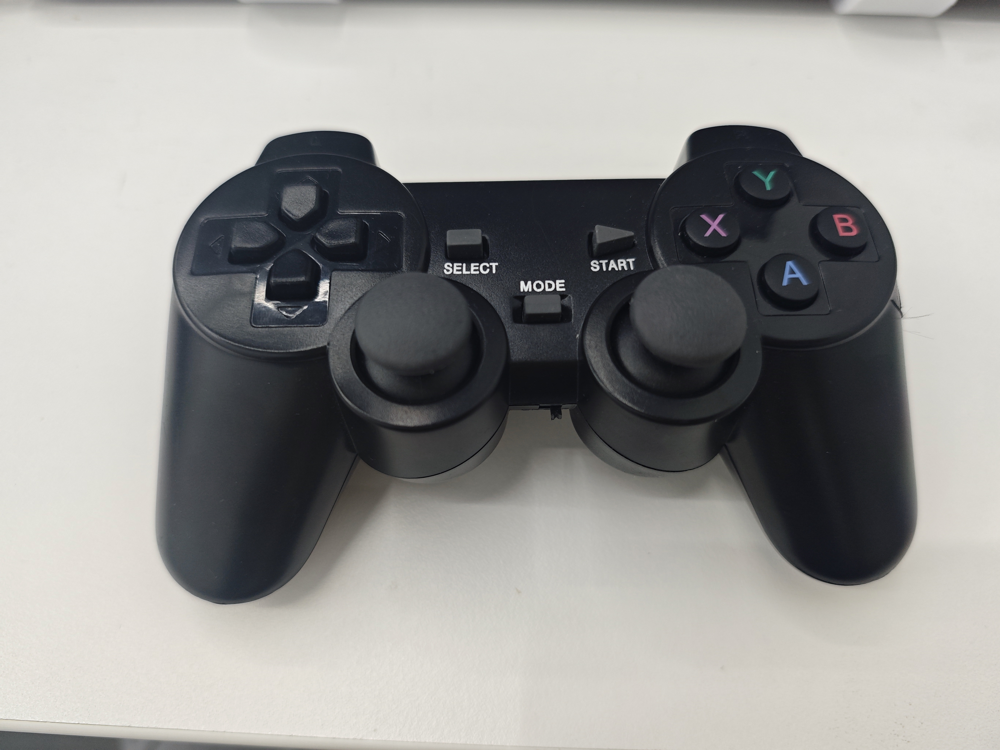

# 6.1.8 Joystick Control (Debian Terminal and Source)

Prefer App Lab with the `Robot Handle Control` built-in case (or ZIP) for joystick control. Setup steps and button definitions: [6.2.2 App Lab SBC Joystick Control](../6.2-applab/6.2.2-Joystick.md).

This section covers running the control program from the **UNO Q Debian terminal**, plus mapping-test and full-control source for review and secondary development. Secure the base, clear the workspace, and keep only one control entry active.

Button mappings, peripheral requirements, and L2 safety warnings match the App Lab page; see [6.2.2 Joystick Control](../6.2-applab/6.2.2-Joystick.md).



## 1. Running via the UNO Q Python Terminal

1. Connect the Hub as described in [6.2.1 SBC Mode](../6.2-applab/6.2.1-GettingStarted.md#7-sbc-mode-optional), and plug the joystick receiver into the Hub.
2. Ensure that the `pymycobot` (UNO Q-compatible version) and `pygame` libraries are installed on the device. If `pygame` is missing, please install it according to the instructions provided for your environment.
3. Navigate to the example directory and launch the script:

```bash
cd ~/mycobot/example/
python3 myCobot280_unoq_handle_control.py
```

4. Once "Joystick detected" is displayed, it is recommended to first press the R1 button, then perform a small test movement using the joystick. Press `Ctrl+C` to stop; the script will automatically call `stop()`, and the robotic arm will also come to a halt if the joystick is disconnected.

Alternatively, you may run the mapping test script provided below to verify the `axis`, `button`, and `hat` indices before launching the main control script.

## 2. Mapping Test Source Code (Debian Terminal)

The mapping test does not connect to the robotic arm or send motion commands; instead, it outputs diagnostic information from `/dev/input`. This is useful for troubleshooting issues related to the receiver, drivers, or detection by `pygame`.

```python
# coding:utf-8
import glob
import os
import platform
import stat
import sys
import time

import pygame


RETRY_SECONDS = 2.0
AXIS_PRINT_THRESHOLD = 0.2
DIAG_INTERVAL = 5


def format_mode(path):
    try:
        mode = os.stat(path).st_mode
    except OSError as exc:
        return "stat failed: {}".format(exc)
    return stat.filemode(mode)


def print_input_diagnostics():
    print("pygame joystick count: {}".format(pygame.joystick.get_count()))
    if platform.system() == "Windows":
        print_windows_diagnostics()
    else:
        print_linux_diagnostics()


def print_windows_diagnostics():
    print("Current system: Windows")
    print("If pygame cannot detect the gamepad, first confirm that Windows recognizes it:")
    print("  1. Open Device Manager and check for an Xbox 360 Controller or game controller device.")
    print("  2. Press Win+R, run joy.cpl, and confirm that the gamepad appears in the Game Controllers list.")
    print("  3. If joy.cpl recognizes it but pygame does not, reconnect the USB receiver or restart the Python process.")
    print("  4. If using a virtual environment, confirm that pygame is installed in that environment.")


def print_linux_diagnostics():
    js_devices = sorted(glob.glob("/dev/input/js*"))
    event_devices = sorted(glob.glob("/dev/input/event*"))
    input_names = sorted(glob.glob("/dev/input/by-id/*")) + sorted(glob.glob("/dev/input/by-path/*"))

    print("Current system: {}".format(platform.system()))
    print("/dev/input/js*: {}".format(js_devices if js_devices else "none"))
    for path in js_devices:
        print("  {} {}".format(path, format_mode(path)))
    print("/dev/input/event* count: {}".format(len(event_devices)))
    if input_names:
        print("/dev/input links:")
        for path in input_names:
            try:
                target = os.readlink(path)
            except OSError:
                target = ""
            print("  {} -> {}".format(path, target))
    print("If lsusb shows the gamepad but /dev/input/js0 is absent, joydev/xpad has usually not created a joystick device.")
    print("Check: lsmod | grep -E 'joydev|xpad'")
    print("Try: sudo modprobe joydev")
    print("If js0 is still absent, try: sudo modprobe xpad")
    print_proc_input_devices()


def print_proc_input_devices():
    path = "/proc/bus/input/devices"
    try:
        with open(path, "r", encoding="utf-8", errors="replace") as input_file:
            content = input_file.read().strip()
    except OSError as exc:
        print("Failed to read {}: {}".format(path, exc))
        return

    if not content:
        print("{} is empty.".format(path))
        return

    print("{}:".format(path))
    for block in content.split("\n\n"):
        lower_block = block.lower()
        if "xbox" in lower_block or "joystick" in lower_block or "gamepad" in lower_block:
            print(block)


def wait_for_joystick():
    retry_count = 0
    while True:
        for event in pygame.event.get():
            if event.type == pygame.QUIT:
                pygame.quit()
                sys.exit()

        pygame.joystick.quit()
        pygame.joystick.init()
        if pygame.joystick.get_count() > 0:
            joystick = pygame.joystick.Joystick(0)
            joystick.init()
            print("Gamepad detected: {}".format(joystick.get_name()))
            print("Axis count: {}".format(joystick.get_numaxes()))
            print("Button count: {}".format(joystick.get_numbuttons()))
            print("D-pad count: {}".format(joystick.get_numhats()))
            print("Press A/B/X/Y, L/R, the sticks, and the D-pad in turn. Press Ctrl+C to exit.")
            pygame.event.clear()
            return joystick

        print("No gamepad USB receiver detected. Retrying in {} seconds...".format(RETRY_SECONDS))
        retry_count += 1
        if retry_count % DIAG_INTERVAL == 0:
            print_input_diagnostics()
        time.sleep(RETRY_SECONDS)


def print_button_event(event):
    state = "down" if event.type == pygame.JOYBUTTONDOWN else "up"
    print("button {} {}".format(event.button, state))


def print_axis_event(event):
    value = round(event.value, 3)
    if abs(value) >= AXIS_PRINT_THRESHOLD:
        print("axis {} value {}".format(event.axis, value))
    elif value == 0:
        print("axis {} value 0".format(event.axis))


def print_hat_event(event):
    print("hat {} value {}".format(event.hat, event.value))


def main():
    print("pygame version: {}".format(pygame.version.ver))
    print("SDL version: {}".format(pygame.get_sdl_version()))
    pygame.init()
    pygame.joystick.init()
    joystick = None

    try:
        joystick = wait_for_joystick()
        while True:
            for event in pygame.event.get():
                if event.type == pygame.QUIT:
                    return
                if event.type in (pygame.JOYBUTTONDOWN, pygame.JOYBUTTONUP):
                    print_button_event(event)
                elif event.type == pygame.JOYAXISMOTION:
                    print_axis_event(event)
                elif event.type == pygame.JOYHATMOTION:
                    print_hat_event(event)
                elif event.type == getattr(pygame, "JOYDEVICEREMOVED", None):
                    print("Gamepad disconnected. Waiting for reconnection.")
                    joystick = None
                    joystick = wait_for_joystick()
                elif event.type == getattr(pygame, "JOYDEVICEADDED", None) and joystick is None:
                    joystick = wait_for_joystick()
            time.sleep(0.01)
    except KeyboardInterrupt:
        print("\nExiting gamepad mapping test.")
    finally:
        if joystick:
            joystick.quit()
        pygame.quit()


if __name__ == "__main__":
    main()
```

## 3. Complete Source Code for Gamepad Control

Since external `.py` files cannot be downloaded from a PDF document, the Python source code for gamepad control (for Debian-based systems) is provided here. This code is also available in the example directory at `example/myCobot280_unoq_handle_control.py`; for further development, it is recommended to use this script as a base. For App Lab users, please prioritize using the provided ZIP example—refer to [6.2.2](../6.2-applab/6.2.2-Joystick.md).

The button numbers used in the source code are default values ​​verified within the project's tested environment. If you change your gamepad, receiver, system image, or the version of `pygame`/SDL, please perform a mapping test first, and then adjust the axis and button numbers in the code accordingly.

```python
# coding:utf-8
# Arduino UNO Q Bridge joystick control demo for myCobot280.
import sys
import threading
import time

import pygame
from pymycobot import MyCobot280


# UNO Q Debian local control. The default UNO Q Bridge baudrate is 1000000.
mc = MyCobot280(unoq_bridge=True)
robot_lock = threading.RLock()

INIT_ANGLES = [0, 0, -90, 0, 0, 0]
GO_HOME = [0, 0, 0, 0, 0, 0]
JOG_SPEED = 50
DEAD_ZONE = 0.3
JOYSTICK_RETRY_SECONDS = 2.0

AXIS_MAP = {
    # Xbox 360 Controller on UNO Q / pygame:
    # left stick horizontal=axis 0, left stick vertical=axis 1,
    # left trigger=axis 2, right stick horizontal=axis 3,
    # right stick vertical=axis 4, right trigger=axis 5.
    "x": 1,
    "y": 0,
    "z": 4,
    "rz": 3,
}
RELEASE_AXIS = 2
POWER_AXIS = 5

BUTTON_MAP = {
    # A=0, B=1, X=2, Y=3, L1=4, R1=5.
    "gripper_open": 2,
    "gripper_close": 3,
    "pump_on": 0,
    "pump_off": 1,
    "to_init": 5,
    "to_home": 4,
}

COORD_AXIS_ACTIONS = {
    AXIS_MAP["y"]: (2, 1, 0),
    AXIS_MAP["x"]: (1, 1, 0),
    AXIS_MAP["z"]: (3, 0, 1),
    AXIS_MAP["rz"]: (6, 0, 1),
}

HAT_ACTIONS = {
    (0, -1): (4, 0),
    (0, 1): (4, 1),
    (-1, 0): (5, 1),
    (1, 0): (5, 0),
}

COORD_NAMES = {
    1: "X",
    2: "Y",
    3: "Z",
    4: "RX",
    5: "RY",
    6: "RZ",
}

previous_axis_state = {}
previous_hat = (0, 0)
stop_thread = None
joystick = None


def robot_call(name, *args):
    with robot_lock:
        return getattr(mc, name)(*args)


def log_action(label, api_name, *args):
    print("{} -> {}({})".format(label, api_name, ", ".join(str(arg) for arg in args)))


def pump_on():
    log_action("A button: turn on pump", "set_digital_output", 33, 0)
    robot_call("set_digital_output", 33, 0)
    time.sleep(0.05)


def pump_off():
    log_action("B button: turn off pump", "set_digital_output", 33, 1)
    robot_call("set_digital_output", 33, 1)
    time.sleep(0.05)
    log_action("B button: open release valve", "set_digital_output", 23, 0)
    robot_call("set_digital_output", 23, 0)
    time.sleep(1)
    log_action("B button: close release valve", "set_digital_output", 23, 1)
    robot_call("set_digital_output", 23, 1)
    time.sleep(0.05)


def safe_stop():
    try:
        log_action("Stick/D-pad centered: stop motion", "stop")
        robot_call("stop")
        time.sleep(0.02)
    except Exception as exc:
        print("stop failed:", exc)


def request_stop():
    global stop_thread
    if stop_thread and stop_thread.is_alive():
        return
    stop_thread = threading.Thread(target=safe_stop, daemon=True)
    stop_thread.start()


def reset_joystick_state():
    global previous_hat
    previous_axis_state.clear()
    previous_hat = (0, 0)


def wait_for_joystick():
    global joystick
    while True:
        for wait_event in pygame.event.get():
            if wait_event.type == pygame.QUIT:
                pygame.quit()
                sys.exit()

        pygame.joystick.quit()
        pygame.joystick.init()
        if pygame.joystick.get_count() > 0:
            joystick = pygame.joystick.Joystick(0)
            joystick.init()
            reset_joystick_state()
            print("Gamepad detected: {}".format(joystick.get_name()))
            pygame.event.clear()
            return

        print("No gamepad USB receiver detected. Retrying in {} seconds...".format(JOYSTICK_RETRY_SECONDS))
        time.sleep(JOYSTICK_RETRY_SECONDS)


def axis_direction(value):
    if value > DEAD_ZONE:
        return 1
    if value < -DEAD_ZONE:
        return -1
    return 0


def handle_axis_motion(event):
    axis = event.axis
    direction = axis_direction(event.value)

    if previous_axis_state.get(axis, 0) == direction:
        return
    previous_axis_state[axis] = direction

    if direction == 0:
        request_stop()
        return

    if axis in COORD_AXIS_ACTIONS:
        coord_id, negative_dir, positive_dir = COORD_AXIS_ACTIONS[axis]
        move_dir = positive_dir if direction > 0 else negative_dir
        label = "axis {} value {:.2f}: {} direction {}".format(
            axis,
            event.value,
            COORD_NAMES.get(coord_id, coord_id),
            "increase" if move_dir == 1 else "decrease",
        )
        log_action(label, "jog_coord", coord_id, move_dir, JOG_SPEED)
        robot_call("jog_coord", coord_id, move_dir, JOG_SPEED)
    elif axis == RELEASE_AXIS and direction > 0:
        log_action("L2 trigger: release all joints", "release_all_servos")
        robot_call("release_all_servos")
        time.sleep(0.03)
    elif axis == POWER_AXIS and direction > 0:
        log_action("R2 trigger: power on and lock joints", "power_on")
        robot_call("power_on")
        time.sleep(0.03)


def handle_button_down():
    if joystick is None:
        return

    if joystick.get_button(BUTTON_MAP["gripper_open"]):
        log_action("X button: open gripper", "set_gripper_state", 0, 100, 1)
        robot_call("set_gripper_state", 0, 100, 1)
    elif joystick.get_button(BUTTON_MAP["gripper_close"]):
        log_action("Y button: close gripper", "set_gripper_state", 1, 100, 1)
        robot_call("set_gripper_state", 1, 100, 1)
    elif joystick.get_button(BUTTON_MAP["pump_on"]):
        pump_on()
    elif joystick.get_button(BUTTON_MAP["pump_off"]):
        pump_off()
    elif joystick.get_button(BUTTON_MAP["to_init"]):
        log_action("R1 button: move to initial position", "send_angles", INIT_ANGLES, JOG_SPEED)
        robot_call("send_angles", INIT_ANGLES, JOG_SPEED)
        time.sleep(2)
    elif joystick.get_button(BUTTON_MAP["to_home"]):
        log_action("L1 button: move to zero position", "send_angles", GO_HOME, JOG_SPEED)
        robot_call("send_angles", GO_HOME, JOG_SPEED)
        time.sleep(3)


def handle_hat_motion():
    global previous_hat
    if joystick is None:
        return

    hat_value = joystick.get_hat(0)
    if hat_value == previous_hat:
        return
    previous_hat = hat_value

    if hat_value == (0, 0):
        request_stop()
        return

    if hat_value in HAT_ACTIONS:
        coord_id, move_dir = HAT_ACTIONS[hat_value]
        label = "D-pad {}: {} direction {}".format(
            hat_value,
            COORD_NAMES.get(coord_id, coord_id),
            "increase" if move_dir == 1 else "decrease",
        )
        log_action(label, "jog_coord", coord_id, move_dir, JOG_SPEED)
        robot_call("jog_coord", coord_id, move_dir, JOG_SPEED)


def joy_handler(event):
    device_added_event = getattr(pygame, "JOYDEVICEADDED", None)
    device_removed_event = getattr(pygame, "JOYDEVICEREMOVED", None)

    if event.type == device_added_event and joystick is None:
        wait_for_joystick()
        return
    if event.type == device_removed_event:
        handle_joystick_disconnect()
        return

    if event.type == pygame.JOYAXISMOTION:
        handle_axis_motion(event)
    elif event.type == pygame.JOYBUTTONDOWN:
        handle_button_down()
    elif event.type == pygame.JOYHATMOTION:
        handle_hat_motion()


def handle_joystick_disconnect():
    global joystick
    print("Gamepad disconnected. Stopping the robot and waiting for reconnection.")
    request_stop()
    joystick = None
    reset_joystick_state()


pygame.init()
pygame.joystick.init()
wait_for_joystick()
print("UNO Q gamepad control started. Press Ctrl+C to exit.")

running = True
try:
    while running:
        for event in pygame.event.get():
            if event.type == pygame.QUIT:
                running = False
            else:
                try:
                    joy_handler(event)
                except pygame.error as exc:
                    print("Failed to read the gamepad: {}. Waiting for reconnection.".format(exc))
                    handle_joystick_disconnect()

        if joystick is None and running:
            wait_for_joystick()
        time.sleep(0.01)
except KeyboardInterrupt:
    print("\nCtrl+C received. Stopping the robot and exiting.")
finally:
    try:
        request_stop()
        if stop_thread:
            stop_thread.join(timeout=0.5)
    finally:
        pygame.quit()
```

## 4. Common Issues

| Symptom | Troubleshooting Steps |
| --- | --- |
| Controller not detected by the terminal | Check the receiver, pairing status, Hub power supply, and `pygame` installation; run the mapping test script provided in this section first. |
| Incorrect directional movement or buttons not responding | Stop immediately; verify the `axis`, `button`, or `hat` mappings using the mapping test script. |
| Cannot find `/dev/input/js*` | Run `ls -l /dev/input/js*` in the UNO Q terminal to verify the driver and device nodes. |
| Suction pump or gripper not responding | Ensure the peripheral is installed and wired correctly; do not press A/B/X/Y if no peripheral is installed. |
| Robotic arm not responding | Stop other control inputs first, then check the power supply, wiring, and terminal output. |
| Importing a ZIP file via App Lab | Refer to [6.2.2 App Lab SBC Controller Control](../6.2-applab/6.2.2-Joystick.md). |

[← Previous Section](./6.1.7-GripperPump.md) | [Next Section →](./6.1.9-Examples.md)
