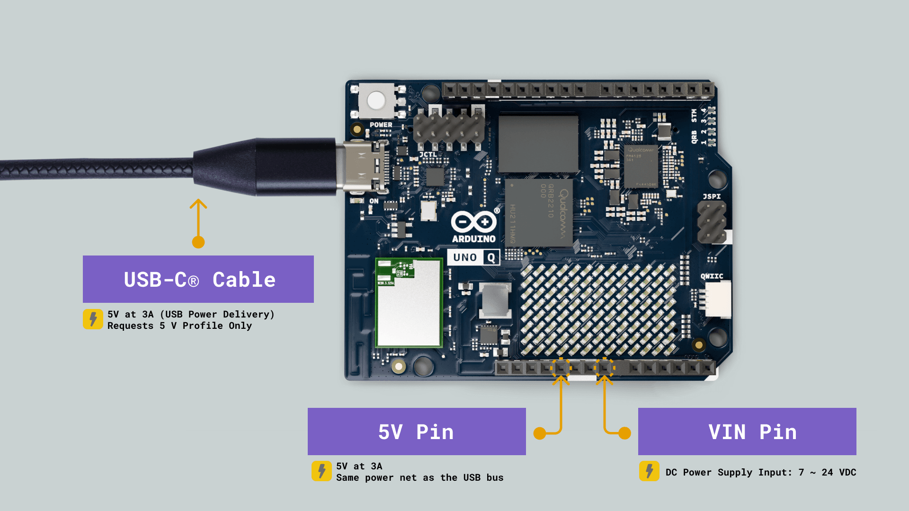
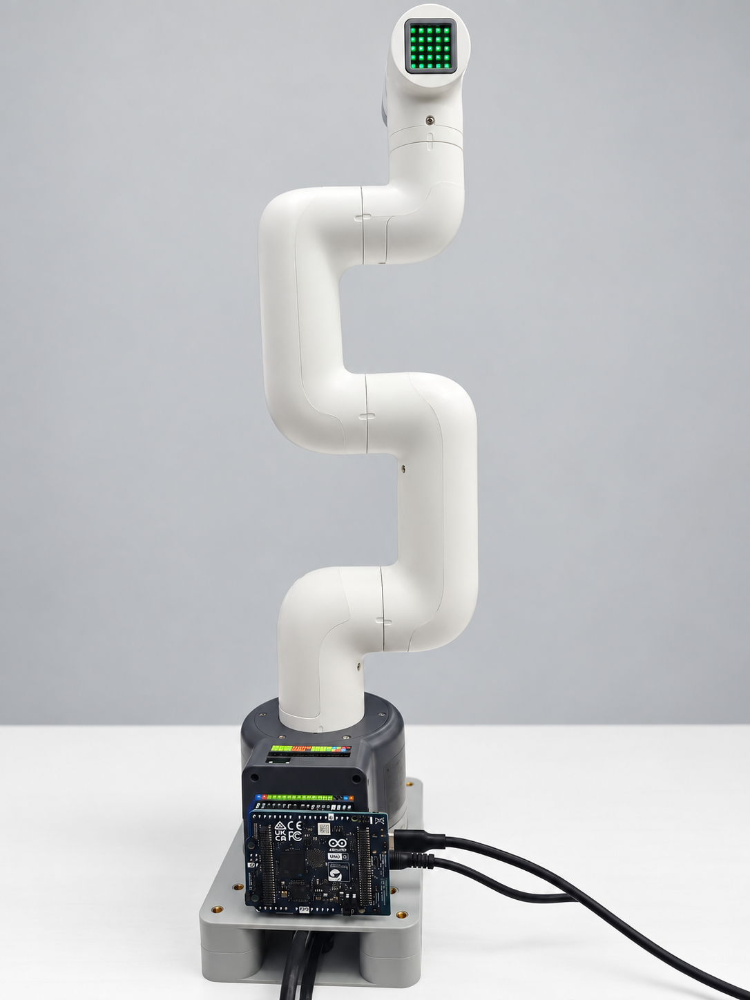
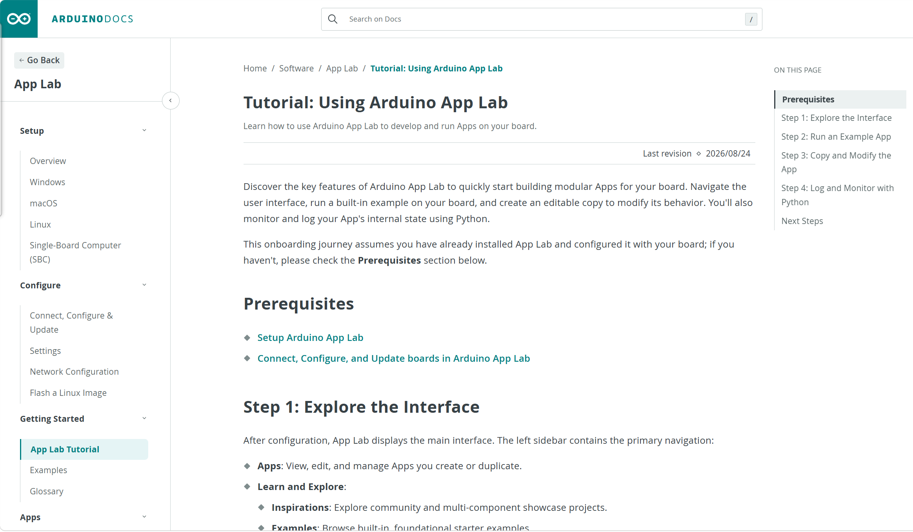

# 6.2.1 Getting Started with App Lab

This section explains how to install and connect Arduino App Lab, open myCobot examples (built-in cases or ZIP import), and modify `python/main.py`. Complete the RGB verification here before joystick or other development work.

App Lab section overview: [6.2 README](./README.md). Onboard Debian Python and TCP Socket: [6.1](../6.1-python/README.md).

## 1. Read the Official UNO Q User Manual First

Please refer to official Arduino documentation for details on the UNO Q’s power supply, USB-C interface, display, networking, and system functions. Before powering on the device for the first time or connecting peripherals, please read the [Arduino UNO Q User Manual](https://docs.arduino.cc/tutorials/uno-q/user-manual/).

This GitBook covers only the integration of the UNO Q with the myCobot 280 and is not a substitute for the official board manual. In the event of any discrepancy, the latest version of the official documentation takes precedence.

## 2. App Lab Usage Modes

| Mode | Target Users | Recommended Use Case |
| --- | --- | --- |
| PC-hosted | First-time users, general customers | Connect the UNO Q to a PC via USB-C to import and run examples; **recommended starting point** |
| SBC | Users with a monitor, keyboard, and mouse | Run App Lab directly on the UNO Q; required for controller-based examples |

Only one program can control the robotic arm at any given time. Before switching examples or modifying code, please click **Stop** and wait for the current application to shut down completely.

> For initial verification, customers only need PC-hosted mode and the RGB example; underlying communication details are not required yet.

## 3. Hardware Preparation

- myCobot 280 for Arduino and its power supply
- Arduino UNO Q
- Connect the UNO Q to the robotic arm according to the provided wiring instructions (Communication: `5V` / `GND` / `TX` / `RX`)
- For PC-hosted setups: A USB-C cable that supports data transmission
- For SBC (Single-Board Computer) setups: Monitor, keyboard, and mouse; for a game controller, a receiver and an externally powered USB hub are also required.

By default, the UNO Q is powered via **USB-C**, which also serves as the connection to the computer. If you choose to use the 5V or VIN pins instead, please follow the official Arduino user manual strictly for wiring, and ensure that multiple power sources are not connected simultaneously.



Figure 6.2.1-1 UNO Q power supply options (Source: Official Arduino UNO Q User Manual)



Figure 6.2.1-2 Physical connection between UNO Q and myCobot 280

## 4. Safety Precautions

1. Secure the base and verify that all power and communication cables are correctly connected. Do not modify communication pin connections or peripheral power supply connections while the device is powered on.
2. Clear the robot's range of motion, ensure personnel remain at a safe distance from the joints and the end-effector, and have an emergency stop mechanism ready.
3. Perform checks that involve no movement or low risk (such as testing the RGB lights) before executing homing sequences or joint movements.
4. Homing sequences involve robot movement; do not initiate them if there is insufficient space.
5. When using peripherals such as grippers or suction pumps, ensure they are properly installed and wired before operation.

## 5. Installing Arduino App Lab

Arduino App Lab is used for developing and running apps on the UNO Q (this project primarily utilizes Python).

### 5.1 Download

Visit [Arduino Software](https://www.arduino.cc/en/software/#app-lab-section) and download the version from the **Arduino App Lab** section. Be careful not to select Arduino IDE or Arduino Lab for MicroPython by mistake. Always use the latest version provided on the official website.


Figure 6.2.1-3: Official installation instructions for Arduino App Lab on Windows (Source: Official Arduino Documentation)

Official documentation: [Setup Arduino App Lab on Windows](https://docs.arduino.cc/software/app-lab/setup/windows/)

### 5.2 Installation on Windows

1. Download the appropriate installer (choose x64 for standard Windows; choose ARM for Windows 11 on ARM).
2. Run the `.exe` file, follow the installation wizard to complete the setup, and launch App Lab.
3. Verify that the application has started correctly by checking the window title or the "About" section.

To perform a manual update, download the latest installer and follow the prompts to overwrite the existing installation; refer to the [manual update instructions](https://support.arduino.cc/hc/en-us/articles/24305472458652-Manually-update-Arduino-App-Lab).

### 5.3 Linux

- **Linux**: Download the `.tar.gz` file, extract it, and follow the instructions included within the package to launch the application. [Linux installation instructions](https://docs.arduino.cc/software/app-lab/setup/linux/)

## 6. Initial Connection and Configuration (PC-hosted)

1. Ensure the robotic arm and the UNO Q are properly powered.
2. Connect the UNO Q to your computer using a USB-C cable that supports data transmission (charge-only cables will not be recognized).
3. Launch App Lab and wait for the UNO Q to start up; the initial detection may take approximately 60 seconds.
4. Select the UNO Q in the device section and follow the on-screen prompts to configure the device name, Linux password, and network settings.
5. If prompted for software or board-level system updates, save your project first, then proceed with the updates as instructed and restart App Lab.
6. Once the initial USB configuration is complete, you can connect via a local area network (LAN).


Figure 6.2.1-4 Connecting, Configuring, and Updating UNO Q (Source: Official Arduino Documentation)

Original Documentation: [Connect, Configure and Update](https://docs.arduino.cc/software/app-lab/configure/config/)

> Please keep the device password set during the initial setup in a secure place. There is no universal default password; do not share your password in any public forum or channel.

## 7. SBC Mode (Optional)

In SBC (Single-Board Computer) mode, the UNO Q runs the pre-installed App Lab directly—connected to a monitor, keyboard, and mouse—eliminating the need for a USB cable connection to an external computer.


Figure 6.2.1-5 SBC Mode vs. PC-hosted Mode (Source: Official Arduino UNO Q User Manual)

On the left is SBC mode: the UNO Q is connected to a monitor, keyboard, and mouse via a powered (externally supplied) USB-C hub. On the right is PC-hosted mode: the UNO Q is connected to a computer via a USB-C cable.

- When connecting external peripherals such as keyboards, mice, or game controller receivers, it is recommended to use a powered (externally supplied) USB hub.
- Upon first use, follow on-screen steps for network, password, and system updates.
- The joystick example in this project uses SBC mode; see [6.2.2 App Lab SBC Joystick Control](./6.2.2-Joystick.md).

Official source: [Single-Board Computer Mode](https://docs.arduino.cc/software/app-lab/setup/standalone/)

## 8. Running myCobot Examples

In the delivered environment, myCobot examples usually appear as **App Lab Built-in Cases** on the **Apps** page. You can also import a complete App ZIP (structure below).

```text
app.yaml
python/
  main.py
  requirements.txt
  pymycobot-*-unoq-*.whl
```

- `app.yaml`: App configuration
- `python/main.py`: Program entry
- `requirements.txt` + local `pymycobot` wheel: UNO Q–adapted dependencies; do not replace with a standard unadapted package

### 8.1 Open and Run

1. Launch App Lab and select your configured UNO Q.
2. Open **Apps** on the left. Find the myCobot **Built-in Case** apps (for example Control Robot RGB, Robot Go Home) and open the one you need.
3. (Optional) To import yourself: on the Apps page use **Import** with a complete ZIP, or place `app.yaml` and `python/` into a new App while keeping relative paths. Import the full package; do not copy only `main.py`.
4. Click **Run** in the top-right. Wait for dependency deploy and start; the first run may be slower.
5. Check Start-up and Main / Python output in the Console.
6. When finished, click **Stop** and wait until the app fully stops before switching examples.



Figure 6.2.1-6 Arduino App Lab Quickstart (Source: Official Arduino Documentation)

Original documentation: [Tutorial: Using Arduino App Lab](https://docs.arduino.cc/software/app-lab/getting-started/quickstart/)

### 8.2 Recommended Sequence

Built-in cases on the Apps page look like this:


Figure 6.2.1-7 myCobot Built-in Cases on the App Lab Apps page

| Example | Function | Prerequisites |
| --- | --- | --- |
| Control Robot RGB | End RGB color cycle (no motion) | **First verification example** |
| Robot Go Home | Homing / zero pose | Clear workspace |
| Robot Single Joint Angle | Single-joint motion | Clear workspace |
| Robot Multi Joint Angles | Multi-joint motion | Clear workspace |
| Robot Sway, Robot Dance | Continuous motion demos | Fully clear workspace |
| Robot Gripper | Adaptive gripper | Gripper installed |
| Robot Pump | Pump and release valve | Pump installed and wiring checked |
| Robot Handle Control | Joystick control | SBC mode, receiver, matching driver |

Start with RGB; then Home → single joint → multi joint → continuous motion → peripherals / joystick.

### 8.3 Secondary Development in App Lab

After official examples run reliably, you can modify an existing app:

1. Open the built-in case or imported project in App Lab.
2. Edit `python/main.py` (keep `MyCobot280(unoq_bridge=True)`).
3. Add dependencies in `python/requirements.txt` if needed; keep the UNO Q–adapted `pymycobot` wheel.
4. Save, click **Stop**, then **Run**, and watch Main / Python in the Console.

Do not delete or replace the local `pymycobot-*-unoq-*.whl`, and do not switch to a standard unadapted `pymycobot` package. More API detail: [6.1 Development and Usage with Python](../6.1-python/README.md).

### 8.4 Common Startup Issues

| Symptom | What to check |
| --- | --- |
| No myCobot apps on Apps | Correct UNO Q selected; delivery image includes Built-in Cases |
| Cannot import ZIP | Use a complete App ZIP, not a subdirectory or lone `main.py` |
| UNO Q not detected | Data cable, board boot, App Lab device picker |
| Python dependency install failed | `requirements.txt` and local wheel; keep app structure |
| App runs but arm does not move | Stop other control programs; check power, wiring, Main / Python logs |
| `ModuleNotFoundError: pymycobot` | UNO Q wheel still under `python/` and referenced by `requirements.txt` |

[← Back to 6.2](./README.md) | [Next Section →](./6.2.2-Joystick.md)
