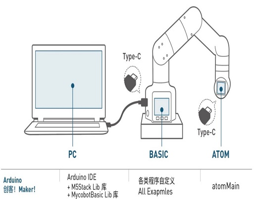
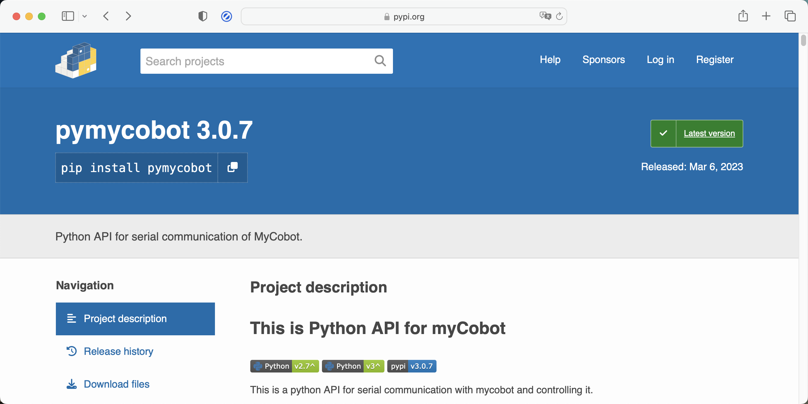
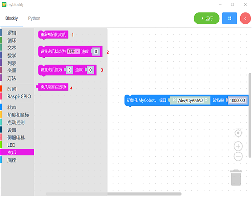
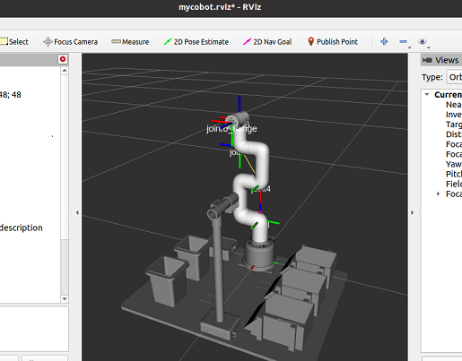

# 开发环境建设

## 1 如何构建环境

Arduino IDE、开发板包、驱动程序以及 MyCobotBasic 库的相关内容，请参阅
[6.1 Arduino 环境搭建](../../6.developmentGuide/Arduino/10.1-arduino_download.md) 中的详细步骤说明。

## 2 基于 Arduino 开发使用
Arduino 是一款简单易用、便于上手的开源电子原型平台，包含硬件部分（各种符合 Arduino 规范的开发板）和软件部分（ Arduino IDE 和相关的开发包）。 硬件部分（或称开发板）由微控制器（MCU）、闪存（Flash）以及一组通用输入/输出接口（GPIO）等构成，你可以将它理解为是一块微型电脑主板。 软件部分则主要由PC端的 Arduino IDE 以及相关的板级支持包（BSP）和丰富的第三方函数库组成。使用者可以借由 Arduino IDE 轻松地下载你所持有的开发板相关的BSP和需要的函数库，用于编写你的程序。我们有一个开源库MyCobotBasic，它是我们公司开发的一款开源机器人控制库，需要使用我们公司开发的机器人方可使用。使用该库，您可以通过蓝牙、WiFi、串口等方式控制我们的机器人，同时支持外接传感器、IIC通信、LED灯等功能。您可以根据自己的需求DIY不同的应用场景，也可以参考我们提供的MiniRobot示例代码或者角度、坐标、夹爪等控制案例。MiniRobot示例代码中包含蓝牙、WiFi、拖动示教、距离传感器等控制相关的内容。用户安装Arduino环境后，可以直接查看 Arduino简单使用和相关接口。详情请查阅Arduino开发指引章节。 

## 3 基于Python 开发使用
我们的机器人支持Python，Python API库的开发也越来越完善。 可以通过Python控制机器人的关节角度、坐标、夹持器等方面。 参考**python开发相关章节**获取更多信息。

## 4 基于Blockly 开发使用
myBlockly是一款全可视化的模块化编程软件，属于图形化编程语言，详情可查阅基于myBlockly开发相关章节。

## 5 基于ROS开发
ROS 是开源的，是用于机器人控制的一种后操作系统，或者说次级操作系统。通过ROS，我们能够在虚拟环境中实现对机械臂的仿真控制。我们将通过 rviz 平台实现对机械臂的可视化，并使用多种方式对我们的机械臂进行操作；通过moveit 平台进行机械臂行动路径的规划和执行，达到自由控制机械臂的效果。

Ros的出现解决了机器人各个部件的通信问题。 后来，越来越多的机器人算法被集成到ROS中。 **ROS2**继承了**ROS**，比**ROS**更强大更好。
与仅支持Linux系统的**ROS**相比，**ROS2**还支持**windows**、**mac**，甚至**RTOS**平台。关于ROS和ROS2开发的更详细内容请查看相关章节。
