# Arduino 环境搭建（UNO R4）

本指南将带你完成从安装 Arduino IDE 到实现机械臂运动的全过程，所用主控板为 **Arduino UNO R4**。请按顺序操作；每一步都明确说明了在进入下一步之前你应该看到的结果。

---

## 1.Arduino IDE 下载

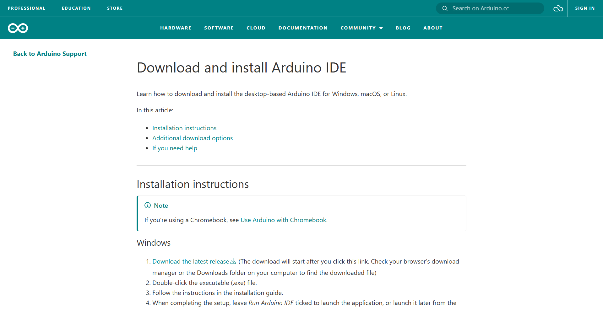

请遵循官方指南：
[下载并安装 Arduino IDE](https://support.arduino.cc/hc/en-us/articles/360019833020-Download-and-install-Arduino-IDE)。
建议使用 2.x 版本。

## 2.安装开发板包

Renesas 核心默认未安装。

1. **Tools --> Board --> Boards Manager**

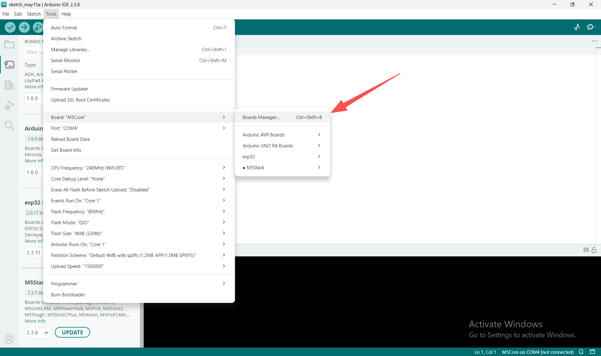

2. 搜索 **Arduino UNO R4 Boards**

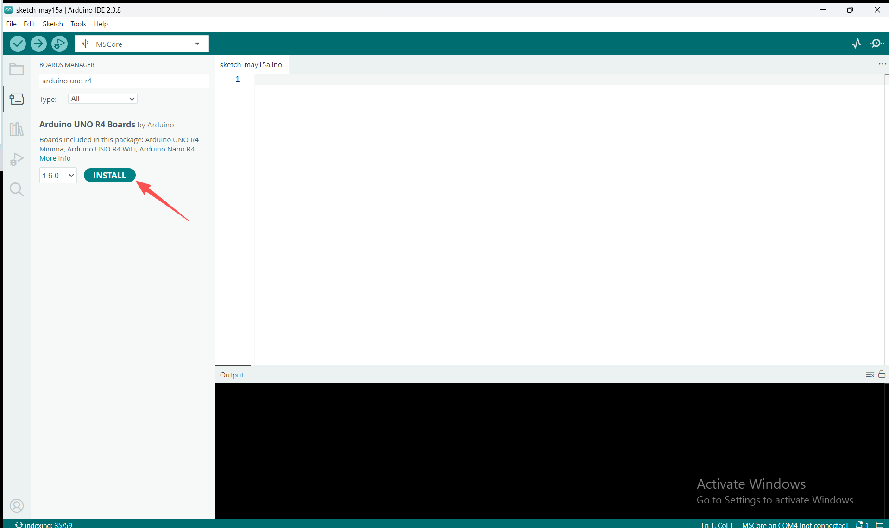

3. 点击 **Install**

**检查：** 该条目显示为已安装。

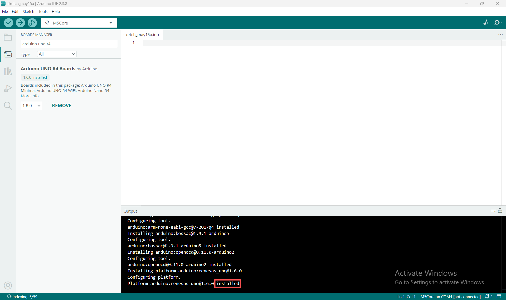

供参考，各主控选项所需的开发板包（Board Package）：

| 主控 | 开发板包 |
| :----------: | :-----------: |
| Arduino UNO / MEGA 2560 | Arduino AVR Boards（通常已预装） |
| Arduino MKR WiFi 1010 | Arduino SAMD Boards |
| Arduino UNO R4 WiFi / Minima | Arduino UNO R4 Boards |

## 3 连接开发板并确认端口

使用 USB-C 线缆将 UNO R4 连接至电脑；此时，**机械臂上暂不要连接任何线路**。

**Tools --> Port** 应该会显示该开发板。在终端中：

```bash
$ arduino-cli board list
Port  Protocol Type              Board Name          FQBN                          Core
COM13 serial   Serial Port (USB) Arduino UNO R4 WiFi arduino:renesas_uno:unor4wifi arduino:renesas_uno
```

如果没有任何反应，**请先尝试更换一根 USB 线**——仅支持充电功能的线缆不包含数据传输线路，这是最常见的原因。

## 4 获取代码

下载最新版本的 [MyCobotBasic](https://github.com/elephantrobotics/MyCobotBasic/tags)（Windows 系统下载 .zip 格式，Linux 系统下载 .tar.gz 格式）。

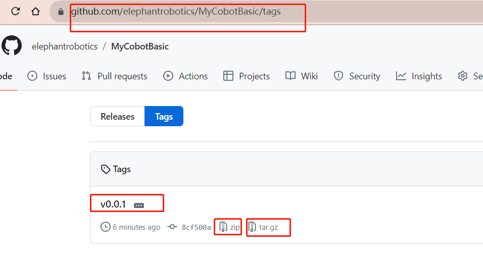

在 Arduino 软件中，通过 **文件 (File) --> 首选项 (Preferences)** 找到你的 Arduino 项目文件夹，然后将下载的文件解压到其中的 `libraries` 目录下，并确保解压后的文件夹名称完全为 `MyCobotBasic`。

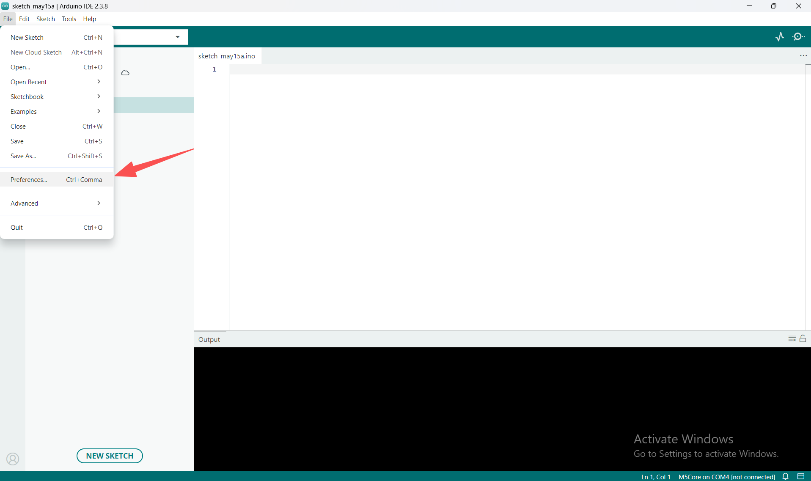

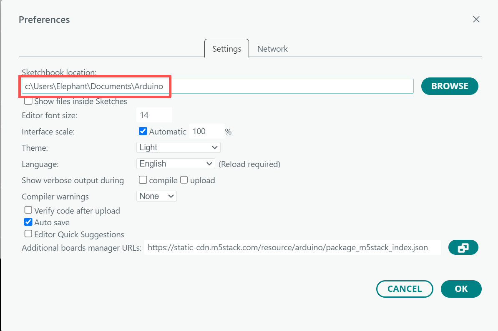

| 操作系统 | 路径 |
| :--: | :--: |
| Windows | `Documents\Arduino\libraries\MyCobotBasic` |
| macOS | `~/Documents/Arduino/libraries/MyCobotBasic` |
| Linux | `~/Arduino/libraries/MyCobotBasic` |

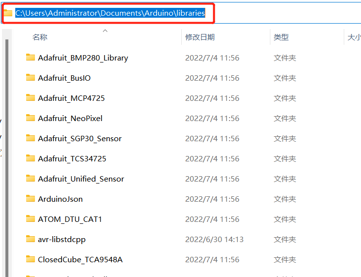

重启 Arduino IDE。

## 5 配置库

使用 UNO R4 配置文件替换库根目录下的 `ParameterList.h`：

```bash
cd MyCobotBasic
cp examples/MyCobot280/MyCobot280_Arduino/Mkr/ParameterList.h  ParameterList.h
```

或者手动编辑根目录下的 `ParameterList.h` 文件——修改第 10 行和第 13 行：

```diff
-#define MyCobot_M5 "m5"
+//#define MyCobot_M5 "m5"

-//#define MyCobot_Mkr "mkr"
+#define MyCobot_Mkr "mkr"
```

`MyCobot_Mkr` 配置方案将机械臂连接映射至 `Serial1`（引脚 D0/D1），这正是 UNO R4 所需的配置。请**不要**选择 `MyCobot_Uno`：该选项会将机械臂映射至 `Serial`（在 R4 上对应 USB 端口），并会引入一个仅适用于 AVR 架构的兼容库，导致编译失败。

> **请修改库根目录下的文件，而非示例文件夹中的文件。**
> `examples/.../Mkr/ParameterList.h` 看起来像是需要修改的文件，因为它已经过预先配置。但它实际上只是一个“模板”文件——编译过程会将其忽略。如果修改该文件并重新编译，依然会遇到同样的 M5Stack 错误。

**检查：** 确保根目录下的 `ParameterList.h` 文件中，`MyCobot_M5` 处于被注释掉的状态，而 `MyCobot_Mkr` 处于启用状态。

然后打开一个示例：

**File --> Examples --> MyCobotBasic --> MyCobot280 --> MyCobot280_Arduino --> Mkr --> AnglesControl**

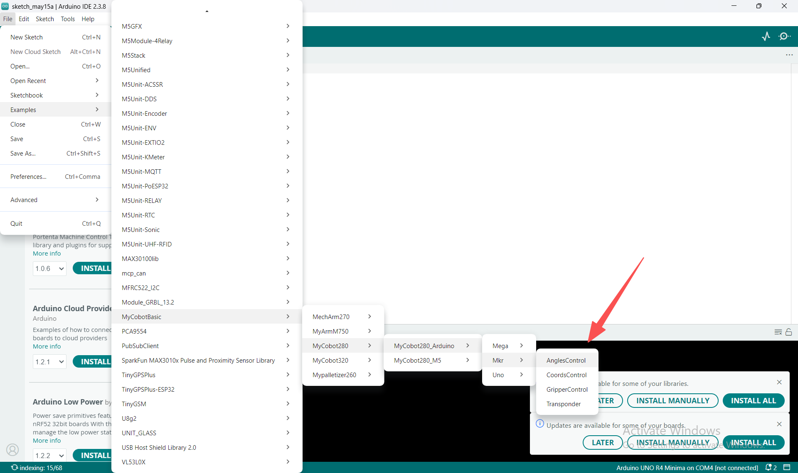

请使用 **`Mkr`** 文件夹。`Mega` 文件夹是为 MEGA 2560 主控板准备的，它将机械臂映射到了不同的串口。

> **在 UNO R4 上使用时，`Mkr/Transponder.ino` 需要进行两处修正。**

> **修复 1 —— 使其能够通过编译。**
>
> ```
> Transponder.ino:131:11: 错误：对“data”的引用不明确
> ```
>
> 该草图使用了 `using namespace std;`，而 R4 内核引入了 `<array>`
> 和 `<string>`，它们都声明了 `std::data`。请重命名第 14 行的全局变量，并
> 修改其在第 131-133 行的用法：
>
> ```diff
> -int count = -1, data = -1;
> +int count = -1, rx_byte = -1;
> ```
>
不要动 `client_data`、`temp_data`、`atom_data` 和 `v_data`。
>
> **修复 2 —— 解决问题。** 仅应用“修复 1”时，程序虽然能完成编译并上传，
> 但 `pymycobot` 却无法获取任何返回数据：尽管机械臂本身做出了正确的响应，
> `get_angles()` 却返回了 `-1`。
>
> `AtomDataToClient()` 在转发数据前会检测到 `FE FE` 帧头：
> ```cpp
> rx_byte = Serial1.read();
> if (rx_byte == HEADER && (temp = Serial1.read()) == HEADER) { ... }
> ```
>
第二次读取操作没有任何防范措施。在 UNO R4 上，数据字节是逐个到达的，因此程序通常会发现缓冲区为空，从而返回 `-1`，同时将 `0xFE` 丢弃，导致整个数据帧被舍弃。此外，`flag` 变量是局部变量，每次函数调用时都会重置，这意味着如果一个数据帧被拆分到多次调用中，它将永远无法被转发出去。请将函数体替换为简单的转发逻辑：
>
> ```cpp
> if (Serial1.available() > 0) {
>     count = 0;
>     int guard = 0;
>     while (Serial1.available() > 0 && guard++ < 64) {
>         Serial.write((uint8_t)Serial1.read());
>     }
> }
> ```
>
`AnglesControl`、`CoordsControl` 和 `GripperControl` 无需修改即可编译。

## 6 选择开发板

**工具 (Tools) --> 开发板 (Board) --> Arduino UNO R4 Boards --> Arduino UNO R4 WiFi**
（或 **Minima**），然后选择 **工具 (Tools) --> 端口 (Port) -->** 对应的端口。

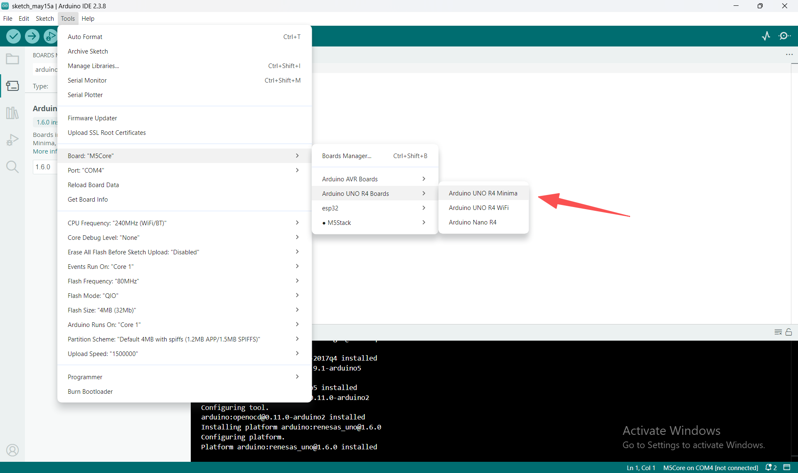

## 7 编译

点击**验证**。

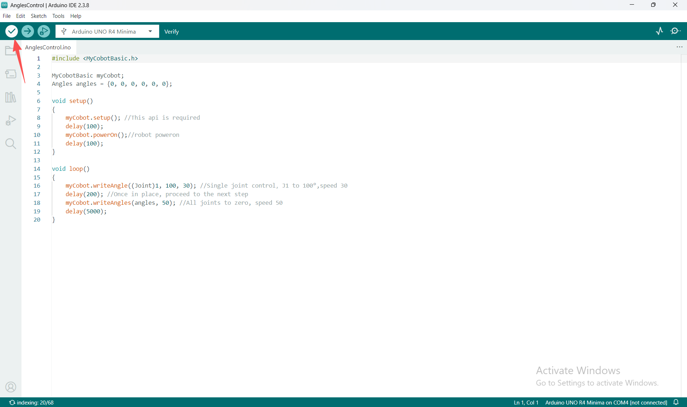

预计大致为：

```
Sketch uses 52604 bytes (20%) of program storage space. Maximum is 262144 bytes.
Global variables use 6908 bytes (21%) of dynamic memory, leaving 25860 bytes.
```

如果失败：

| 错误信息 | 原因 |
|---|---|
| `#error "This library only supports boards with ESP32 processor."` | 未执行第 5 步，或执行位置有误（应用于了错误的文件） |
| `reference to 'data' is ambiguous` | 在 `Mkr/Transponder.ino` 文件中未进行重命名操作 |
| `fatal error: stddef: No such file` | 错误地选择了 `MyCobot_Uno`，应选择 `MyCobot_Mkr` |

## 8 上传

点击**上传**。操作完成后，输出面板末尾会显示 `Done!`。

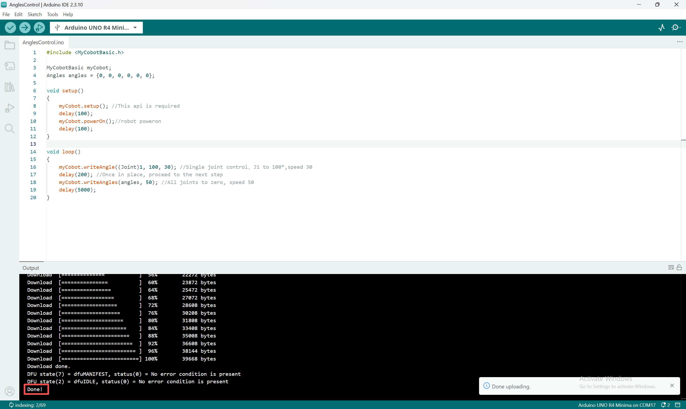

如果出现“串口被占用”（Serial port busy）或“未找到设备”（No device found）的错误：

1. 关闭所有占用该端口的程序——例如串口监视器（Serial Monitor）、Python 会话或 REPL 环境。
2. **重试。** 在端口被释放后，R4 通常需要一点时间来完成状态重置。 
如果前两次尝试失败，但第三次尝试成功，这是正常现象。

## 9 连接机械臂线路

首先关闭机械臂电源，然后按照[4. 首次使用 — 硬件连接](../../../2-BasicSettings/4.FirstTimeInstallation/4-FirstTimeInstallation.md)中的说明进行接线。

## 10 验证运行情况

**AnglesControl** 程序可直接通过 Arduino 控制机械臂，无需连接电脑。
为机械臂上电：J1 关节会转动至 100 度，随后所有关节归零，此过程循环进行。如果机械臂能够动作，则说明工具链、库配置及接线均无误。

如果机械臂没有动作，请检查机械臂是否已独立供电，并确认 D0/D1 引脚是否采用直连方式（即 TX 接 TX，RX 接 RX）——详情请参阅[4. 首次使用 — 硬件连接](../../../2-BasicSettings/4.FirstTimeInstallation/4-FirstTimeInstallation.md)。

## 11 命令行操作方式

在不使用 IDE 的情况下完成同样的构建：

```bash
arduino-cli core install arduino:renesas_uno

arduino-cli compile --fqbn arduino:renesas_uno:unor4wifi     --library ~/Documents/Arduino/libraries/MyCobotBasic     ~/Documents/Arduino/libraries/MyCobotBasic/examples/MyCobot280/MyCobot280_Arduino/Mkr/AnglesControl

arduino-cli upload --fqbn arduino:renesas_uno:unor4wifi -p COM13 <sketch-folder>
```
